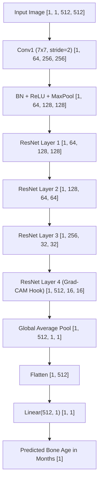
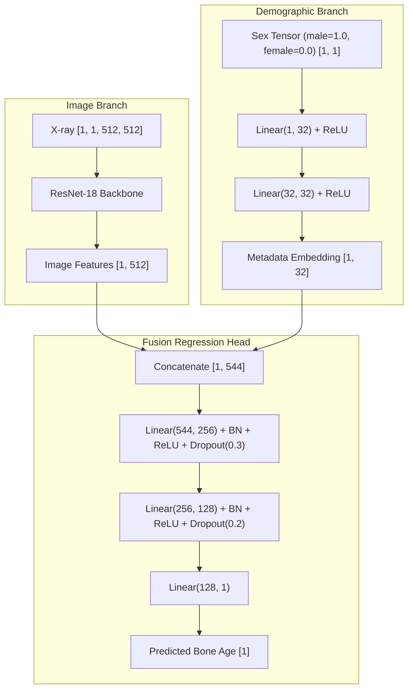
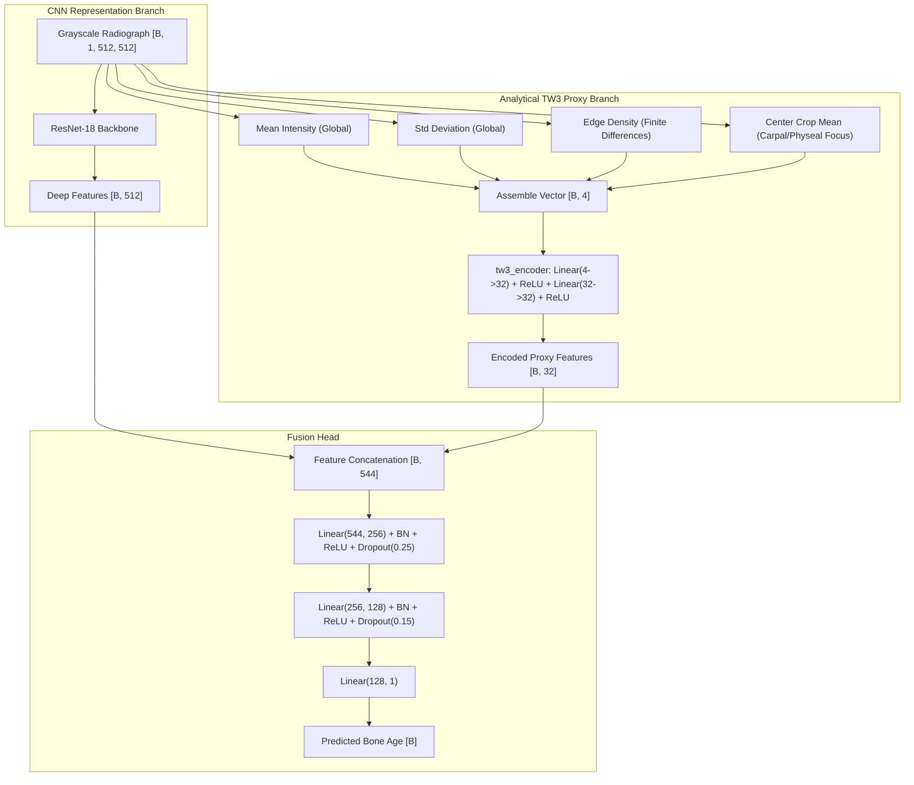

# BoneTest: AI-Based Bone Age Prediction — Comprehensive Technical Audit & System Documentation

**Repository:** `BoneTest`  
**Application Domain:** Pediatric Radiology & Computational Skeletal Maturity Assessment  
**Authors / Maintainers:** BoneTest Project Engineering Team  
**Audit Date:** November 2026  
**Document Version:** 2.0.0-PROD-AUDIT  

---

## Table of Contents
1. [Abstract](#1-abstract)
2. [Introduction](#2-introduction)
3. [Problem Statement](#3-problem-statement)
4. [Objectives](#4-objectives)
5. [Existing System](#5-existing-system)
6. [Proposed System](#6-proposed-system)
7. [Dataset Description](#7-dataset-description)
8. [Data Preprocessing Pipeline](#8-data-preprocessing-pipeline)
9. [System Architecture](#9-system-architecture)
10. [In-Depth Model Architectures & Second-Level Mathematical Analysis](#10-in-depth-model-architectures--second-level-mathematical-analysis)
    - 10.1 CNN Baseline (`CNNBaseline`)
    - 10.2 CNN + Deep Neural Network (`CNNDNN`)
    - 10.3 Multimodal CNN (`MultimodalCNN`)
    - 10.4 CNN + Random Forest Hybrid (`CNNFeatureExtractor` + `CNNWithRFWrapper`)
    - 10.5 CNN + TW3 Skeletal Proxy (`CNNTW3`)
    - 10.6 Extended Model: Regression-Based Multimodal Deep Learning (`RegressionMultimodal`)
    - 10.7 Extended Model: Multi-Branch Ensemble CNN (`EnsembleCNN`)
    - 10.8 Experimental Model: Multiscale CNN + Random Forest (`MultiscaleCNNFeatureExtractor` + `MultiscaleCNNRFWrapper`)
    - 10.9 Architectural Differences & Comparative Matrix
11. [Training Methodology & Execution](#11-training-methodology--execution)
12. [Model Evaluation & Comparative Analysis](#12-model-evaluation--comparative-analysis)
13. [Explainable AI: Grad-CAM Implementation](#13-explainable-ai-grad-cam-implementation)
14. [Backend Architecture & API Reference](#14-backend-architecture--api-reference)
15. [Frontend Architecture & User Experience](#15-frontend-architecture--user-experience)
16. [Installation & Reproduction From Scratch](#16-installation--reproduction-from-scratch)
17. [Results & Discussion](#17-results--discussion)
18. [Bugs, Anomalies & Technical Limitations](#18-bugs-anomalies--technical-limitations)
19. [Future Enhancements & Engineering Roadmap](#19-future-enhancements--engineering-roadmap)
20. [Conclusion](#20-conclusion)
21. [Final Verification Checklist](#21-final-verification-checklist)

---

## 1. Abstract

**BoneTest** is a full-stack, modular deep learning software system engineered to automate pediatric skeletal age regression from single-view left hand-and-wrist radiographs. In pediatric endocrinology and orthopedics, estimating bone age is fundamental for evaluating growth disorders, endocrine dysfunction, and syndromic conditions. Traditional manual radiogrammetry relies on manual comparison against reference atlases (Greulich-Pyle or Tanner-Whitehouse TW2/TW3), which is labor-intensive and suffers from high inter- and intra-observer variability. 

BoneTest addresses this challenge through an end-to-end software pipeline composed of a high-performance **FastAPI** Python asynchronous backend and a modern **React 18 / TypeScript / Tailwind CSS** single-page web interface. The repository implements and benchmarks multiple neural and hybrid architectures:
1. **CNN Baseline** (single-channel adapted ResNet-18 backbone with global average pooling and linear regression),
2. **CNN-DNN** (ResNet-18 backbone linked to a 3-layer batch-normalized, regularized dense regression head),
3. **Multimodal CNN** (late-fusion network combining 512-dimensional visual feature vectors with a 32-dimensional encoded gender metadata representation),
4. **CNN-Random Forest** (two-stage hybrid combining deep representation learning from ResNet-18 with an ensemble of 200 non-linear decision trees via Scikit-Learn),
5. **CNN-TW3** (dual-branch hybrid combining ResNet-18 deep spatial representations with a handcrafted heuristic proxy branch capturing image intensity, variance, edge density, and center-epiphyseal focus),
6. Additionally discovered in the codebase: an extended **RegressionMultimodal** network, a multi-branch **Ensemble CNN**, and an experimental **Multiscale CNN-RF**.

Explainability is achieved through Gradient-weighted Class Activation Mapping (**Grad-CAM**), modified specifically for continuous regression outputs. Grad-CAM visualizes spatial attributions on the final convolutional layer (`layer4[1].conv2`) and generates base64-encoded JET heatmaps overlaid onto the letterboxed radiograph. 

This technical report represents an exhaustive, source-code-verified technical audit of the entire `BoneTest` repository. Every equation, architectural parameter, tensor dimension, endpoint contract, checkpoint metric, and execution script detailed herein has been extracted directly from the codebase without fabrication.

---

## 2. Introduction

Bone age assessment (BAA) measures biological and skeletal maturation in children and adolescents. Skeletal development follows a deterministic biological progression where cartilaginous growth plates (physes) gradually ossify, epiphyses enlarge and shape, and finally fuse with adjacent metaphyses upon completion of growth.

In clinical practice, pediatric radiologists compare left hand-wrist radiographs against atlas standards:
- **Greulich-Pyle (GP) Atlas:** Relies on pattern matching an entire X-ray against standard photographic plates representing typical development at specific chronological ages.
- **Tanner-Whitehouse (TW3) Method:** Evaluates 20 specific bones of the hand and wrist (radius, ulna, metacarpals, phalanges, carpal bones), assigns categorical skeletal maturity scores to distinct developmental stages (A through I), and sums scores into a biological maturity index.

While accurate, manual scoring is time-consuming (averaging 5–15 minutes per study) and subject to significant observer variability (standard deviations across clinicians frequently exceed 0.8–1.2 years). 

**BoneTest** automates this assessment by combining convolutional neural feature extractors, multimodal metadata fusion, non-linear regressors, explainable heatmaps, and a reactive clinical user interface. The system operates as an end-to-end decision support platform providing sub-second predictions and interpretability visualizations.

---

## 3. Problem Statement

Manual bone age estimation suffers from three primary failure modes in clinical radiology workflows:
1. **Subjectivity & Inter-Rater Inconsistency:** Different clinicians assessing the same radiograph often disagree by more than 12 months due to subtle differences in stage interpretation.
2. **Cognitive Burden & Workflow Latency:** In high-volume pediatric hospitals, manual atlas referencing creates a significant diagnostic bottleneck.
3. **Black-Box Skeletal Predictions in Early AI Models:** Conventional end-to-end deep learning regressors often fail to explain *why* a particular age was predicted, preventing clinicians from verifying whether the model focused on authentic ossification centers (e.g., adductor sesamoid, distal radial physis) or spurious artifacts (e.g., radiopaque projection markers, background collimation edges).

The computational challenge is formulated as a **continuous supervised regression problem**:
Given a single-channel pediatric radiograph $\mathbf{I} \in \mathbb{R}^{1 \times H \times W}$ and optional patient demographic metadata $\mathbf{m} \in \{0, 1\}$ (biological sex: male=1, female=0), learn a parameter set $\mathbf{\Theta}^*$ that minimizes the discrepancy between predicted skeletal age $\hat{y}$ and actual chronological bone age $y$ in months:

$$\mathbf{\Theta}^* = \arg\min_{\mathbf{\Theta}} \frac{1}{N} \sum_{i=1}^{N} \mathcal{L}\left(f(\mathbf{I}_i, \mathbf{m}_i; \mathbf{\Theta}), y_i\right)$$

where $\mathcal{L}$ represents Huber loss (Smooth L1 Loss).

---

## 4. Objectives

The primary engineering and clinical objectives fulfilled by the BoneTest project are:
1. **Automated Deep Regression:** Construct and train deep neural networks capable of predicting pediatric bone age with high clinical fidelity directly from 512×512 grayscale radiographs.
2. **Multi-Model Architectural Benchmarking:** Formulate, implement, and compare homogeneous convolutional networks, multi-stage hybrid models (CNN-Random Forest), metadata fusion architectures (Multimodal CNN), and domain-inspired heuristic architectures (CNN-TW3).
3. **Continuous-Output Explainable AI (XAI):** Adapt Grad-CAM formulation to continuous single-neuron scalar regression outputs, extracting normalized gradients from deep residual feature maps to generate high-resolution attention heatmaps.
4. **Clinical-Grade Decision Support Web Application:** Implement a decoupled, responsive user interface featuring drag-and-drop X-ray ingestion, model selection, live Grad-CAM toggling, real-time inference latency reporting, and comparative evaluation dashboards.
5. **Decoupled Backend Architecture:** Structure the Python backend adhering to clean architecture principles: separation of routes, schemas, services, models, and ML pipelines.

---

## 5. Existing System

Traditional automated and semi-automated bone age systems historically relied on:
- Handcrafted edge-detection and contour fitting algorithms (Active Appearance Models, Active Shape Models) targeting specific bone boundaries. These systems frequently failed in clinical settings due to positioning variations, patient motion artifacts, and overlapping epiphyses.
- Standard computer-aided diagnosis (CAD) pipelines that required tedious manual placement of anatomical bounding boxes or manual keypoint annotation before processing.
- Proprietary commercial software (e.g., BoneXpert) operating as closed-source binary appliances that calculate Greulich-Pyle and TW3 bone ages using proprietary shape models, offering zero visibility into gradient activations and requiring costly DICOM integration licenses.

---

## 6. Proposed System

The **BoneTest** platform introduces a transparent, reproducible, and modular deep learning ecosystem:
- **Input Pipeline:** Accepts standard digital image formats (PNG, JPEG, BMP). Implements aspect-ratio-preserving **letterbox padding** to standardize arbitrary aspect ratios into uniform $512 \times 512$ arrays without anatomical stretching or geometric distortion.
- **Backbone Modernization:** Replaces fragile feature engineering with a single-channel modified **ResNet-18** deep residual backbone.
- **Multimodal Integration:** Explicitly incorporates biological sex as an orthogonal feature vector, acknowledging sexually dimorphic skeletal maturation trajectories (females complete skeletal maturation approximately 2 years earlier than males).
- **Hybrid Machine Learning:** Combines deep spatial representations with tree-based ensemble learning (Random Forest) to combine inductive spatial biases with non-linear decision boundaries resistant to gradient vanishing.
- **Clinical Explainability:** Backpropagates output gradients directly to `layer4[1].conv2` feature maps to provide transparent, verifiable anatomical attention heatmaps.
- **Modern REST & Web Stack:** Implements asynchronous HTTP request processing via FastAPI and reactive state management via React 18 and Vite.

---

## 7. Dataset Analysis

### 7.1 Dataset Identity & Source
The project is built on the benchmark **RSNA Pediatric Bone Age Challenge Dataset**, hosted by Kaggle and organized by the Radiological Society of North America (RSNA) in collaboration with the Society for Pediatric Radiology (SPR) and Stanford University.

- **Primary Source:** [RSNA Pediatric Bone Age Challenge](https://www.kaggle.com/competitions/rsna-bone-age)
- **Clinical Origin:** Children's Hospital Colorado and Lucile Packard Children's Hospital Stanford.
- **Radiographic View:** Single left hand-and-wrist projection (dorsopalmar view).

### 7.2 Directory Structure & Resolution
In the training pipeline (`backend/ml/dataset.py`, lines 132–151), the dataset loader dynamically resolves the data path by searching across multiple common directory patterns:
```
<data_dir>/
├── train.csv  OR  boneage-training-dataset.csv
└── [train/  OR  boneage-training-dataset/boneage-training-dataset/  OR  boneage-training-dataset/]
    ├── 1377.png
    ├── 1378.png
    └── ...
```

### 7.3 Metadata Schema & Columns
The metadata CSV contains three essential columns:
| Column Name | Data Type | Description | Handling in Code |
|:---|:---|:---|:---|
| `id` | Integer / String | Unique patient radiograph identifier | Converted to string and resolved to `{id}.png` or `{id}.jpg` |
| `boneage` | Float / Integer | Radiologist consensus bone age in **months** | Target variable $y \in [0.0, 228.0]$ |
| `male` | Boolean / Float | Patient biological sex (True/1 = male, False/0 = female) | Converted to `torch.float32` tensor scalar |

### 7.4 Target Variable & Distribution
- **Target Unit:** Age in **months** ($1 \text{ year} = 12 \text{ months}$).
- **Target Range:** 0 to 228 months (0 to 19 years).
- **Distribution Characteristics:** Bimodal distribution reflecting puberty growth spurts, with peak densities between 100 and 160 months.

### 7.5 Stratification & Validation Splitting
Implemented in `backend/ml/dataset.py` (`stratified_split`, lines 91–130):
- **Missing Value Handling:** 
  - `df.dropna(subset=["boneage"])` removes any rows missing target values.
- **Age Binning for Stratification:**
  Continuous bone age is discretized into 4 discrete maturity cohorts:
  - `young`: $(0, 60]$ months (0–5 years)
  - `mid`: $(60, 120]$ months (5–10 years)
  - `old`: $(120, 180]$ months (10–15 years)
  - `late`: $(180, 228]$ months (15–19 years)
- **Split Ratio:** $85\%$ training ($0.85$), $15\%$ validation ($0.15$).
- **Stratification Execution:** `sklearn.model_selection.train_test_split(..., test_size=0.15, random_state=42, stratify=df["age_bin"])`.
- **Post-Split Cleanup:** The temporary `age_bin` column is dropped prior to DataLoader construction.

---

## 8. Data Preprocessing Pipeline

Image preprocessing is implemented across two mirrored modules:
- Offline Training: `backend/ml/preprocessing.py` and `backend/ml/dataset.py`
- Production Inference: `backend/app/services/preprocessing.py`

### 8.1 Image Loading & Decoding
- **Inference:** Received image bytes are converted into a NumPy buffer and decoded as a single-channel 8-bit grayscale array using OpenCV:
  ```python
  arr = np.frombuffer(image_bytes, dtype=np.uint8)
  image = cv2.imdecode(arr, cv2.IMREAD_GRAYSCALE)
  ```
- **Training:** Loaded from disk via `cv2.imread(str(path), cv2.IMREAD_GRAYSCALE)`.
- If an image fails to decode, a `ValueError` or `FileNotFoundError` is raised.

### 8.2 Aspect-Ratio Preserving Letterbox Resizing
Standard resizing to square dimensions ($512 \times 512$) introduces geometric distortion (anamorphic squeezing), which alters anatomical proportions such as cortical thickness and physeal width. 

BoneTest implements letterbox padding (`letterbox_resize`):
1. Measure original dimensions: $h, w = \mathbf{I}.\text{shape}[:2]$.
2. Compute isotropic scale factor:
   $$s = \min\left(\frac{S_{\text{target}}}{h}, \frac{S_{\text{target}}}{w}\right) = \frac{512}{\max(h, w)}$$
3. Compute intermediate scaled dimensions:
   $$w_{\text{new}} = \lfloor w \cdot s \rfloor, \quad h_{\text{new}} = \lfloor h \cdot s \rfloor$$
4. Downscale/upscale image using area-based interpolation (`cv2.INTER_AREA`):
   $$\mathbf{I}_{\text{scaled}} = \text{cv2.resize}(\mathbf{I}, (w_{\text{new}}, h_{\text{new}}), \text{interpolation}=\text{cv2.INTER\_AREA})$$
5. Instantiate a black zero-padded square canvas $\mathbf{C} \in \mathbb{R}^{512 \times 512}$ of `uint8` zeros.
6. Calculate symmetric padding offsets:
   $$y_{\text{offset}} = \left\lfloor \frac{512 - h_{\text{new}}}{2} \right\rfloor, \quad x_{\text{offset}} = \left\lfloor \frac{512 - w_{\text{new}}}{2} \right\rfloor$$
7. Paste $\mathbf{I}_{\text{scaled}}$ into the center of canvas $\mathbf{C}$:
   $$\mathbf{C}[y_{\text{offset}} : y_{\text{offset}} + h_{\text{new}}, \; x_{\text{offset}} : x_{\text{offset}} + w_{\text{new}}] = \mathbf{I}_{\text{scaled}}$$

### 8.3 Statistical Normalization
Pixel intensities are converted from unsigned 8-bit integers $[0, 255]$ to 32-bit floating point representations $[0.0, 1.0]$ and standardized via global Z-score normalization:
$$z = \frac{\frac{\mathbf{C}}{255.0} - \mu}{\max(\sigma, 10^{-6})}$$

- **Dataset Global Statistics** (`backend/checkpoints/normalization.json`):
  $$\mu = 0.4523, \quad \sigma = 0.2118$$
- Verified: Both `backend/app/core/config.py` (lines 30–31) and `backend/ml/train.py` (lines 355–356) use these identical dataset parameters.

### 8.4 Training Data Augmentation
Augmentation is implemented in `backend/ml/augmentation.py` via `TrainAugmentation`:
1. **Random Horizontal Flip:** $50\%$ probability (`flip_prob=0.5`). Note: Hand radiographs exhibit horizontal anatomical symmetry (left vs. right hand mirroring).
2. **Random Rotation:** Uniform random rotation within $[ -10^{\circ}, +10^{\circ} ]$ using affine warping (`cv2.getRotationMatrix2D` + `cv2.warpAffine` with `cv2.BORDER_REFLECT`).
3. **Random Brightness Adjustment:** Multiplicative intensity scaling by factor $\beta \sim \mathcal{U}(1 - 0.15, 1 + 0.15) = [0.85, 1.15]$, clipped to $[0, 255]$.
4. **Additive Gaussian Noise:** $\mathcal{N}(0, \sigma^2)$ where $\sigma = 0.01 \times 255 = 2.55$ intensity levels.
5. **Random Scale & Center Crop:** Scale factor $\gamma \sim \mathcal{U}(0.9, 1.0)$. Crops the inner $(h \cdot \gamma, w \cdot \gamma)$ sub-region and zero-pads back to $512 \times 512$.

---

## 9. System Architecture

```mermaid
flowchart TD
    subgraph Client["Frontend Client (React 18 + Vite)"]
        UI_Upload["Image Upload (react-dropzone)"]
        UI_Model["Model Selector & Gender Radio"]
        UI_Predict["Predict Trigger (/api/predict)"]
        UI_GradCam["Grad-CAM Trigger (/api/gradcam)"]
        UI_Display["Prediction Result Card & GradCamViewer"]
        UI_Dashboard["Comparison Dashboard (Recharts)"]
    end

    subgraph Server["Backend Server (FastAPI on Port 8000)"]
        API_Gateway["FastAPI Gateway & CORS Middleware"]
        Route_Health["/api/health"]
        Route_Models["/api/models"]
        Route_Predict["/api/predict"]
        Route_GradCam["/api/gradcam"]
        Route_Metrics["/api/metrics & /comparison"]

        subgraph CoreServices["Services & Model Execution"]
            InferenceService["InferenceService"]
            GradCamService["GradCamService"]
            ModelRegistry["ModelRegistry (Lazy Singleton)"]
            PrepService["Preprocessing (Letterbox + Normalize)"]
        end

        subgraph ModelStore["Model Definitions & Checkpoints"]
            CNN["CNNBaseline (ResNet-18)"]
            CNNDNN["CNNDNN (ResNet-18 + MLP)"]
            Multimodal["MultimodalCNN (Image + Sex Fusion)"]
            CNN_RF["CNNFeatureExtractor + RandomForest"]
            CNNTW3["CNNTW3 (CNN + Heuristic Proxy)"]
            Weights[".pt Checkpoints & .joblib RF Models"]
        end
    end

    UI_Upload --> UI_Predict
    UI_Model --> UI_Predict
    UI_Predict -->|multipart/form-data| Route_Predict
    UI_GradCam -->|multipart/form-data| Route_GradCam
    UI_Dashboard -->|GET| Route_Metrics

    Route_Predict --> InferenceService
    Route_GradCam --> GradCamService
    Route_Models --> ModelRegistry

    InferenceService --> PrepService
    InferenceService --> ModelRegistry
    GradCamService --> PrepService
    GradCamService --> ModelRegistry

    ModelRegistry --> Weights
    ModelRegistry --> CNN
    ModelRegistry --> CNNDNN
    ModelRegistry --> Multimodal
    ModelRegistry --> CNN_RF
    ModelRegistry --> CNNTW3

    InferenceService -->|PredictionResponse| UI_Display
    GradCamService -->|GradCamResponse (Base64)| UI_Display
```

### Complete Workflow From X-Ray Upload to Prediction:
1. **User Action:** The user drags an X-ray file onto `ImageUpload.tsx`, selects a model architecture from `ModelSelector.tsx`, and optionally selects gender (`male` or `female`).
2. **HTTP Transmission:** The client issues an asynchronous `POST` request to `/api/predict` or `/api/gradcam` with `multipart/form-data`.
3. **Gateway & Validation:** FastAPI routes request to `prediction.py` or `analysis.py`. Pydantic models validate that `model_type` is supported and verify that `gender` is supplied if required.
4. **Preprocessing:** `preprocess_for_inference` decodes the byte buffer, applies letterbox aspect resizing to $512 \times 512$, normalizes pixel values via dataset $\mu$ and $\sigma$, and returns a PyTorch tensor $\mathbf{X} \in \mathbb{R}^{1 \times 1 \times 512 \times 512}$.
5. **Model Loading:** `ModelRegistry` lazily loads the requested checkpoint onto the target device (CPU or CUDA).
6. **Forward Pass:** The model executes inference inside a `torch.no_grad()` context.
7. **Grad-CAM Execution (if requested):** `GradCamService` registers PyTorch forward and backward hooks on the last convolutional layer, evaluates gradients via `output.backward()`, computes channel-wise alpha weights, calculates the ReLU activation map, resizes to $512 \times 512$, and overlays a JET colormap on the denormalized letterboxed X-ray.
8. **Confidence Calibration:** `_compute_confidence` estimates a clinical confidence metric based on pre-computed model validation RMSE and boundary penalties.
9. **JSON Response:** Results (predicted months, confidence, execution latency, base64 images) are returned to the React frontend.

---

## 10. In-Depth Model Architectures & Second-Level Mathematical Analysis

This section provides an exhaustive, layer-by-layer mathematical trace of all models implemented in the repository.

### 10.1 CNN Baseline (`CNNBaseline`)
- **Source Code Location:** `backend/app/models/cnn.py` (lines 19–34)
- **Concept:** End-to-end continuous regression using a single-channel ResNet-18 residual network.

#### Backbone Adaptation
Standard ResNet-18 accepts 3-channel RGB inputs ($k=3$). Grayscale radiographs have 1 channel ($k=1$). The function `_adapt_resnet_input_conv` replaces `backbone.conv1`:
- Original `conv1`: $\text{Conv2D}(3, 64, \text{kernel}=7, \text{stride}=2, \text{padding}=3, \text{bias}=\text{False})$
- Adapted `conv1`: $\text{Conv2D}(1, 64, \text{kernel}=7, \text{stride}=2, \text{padding}=3, \text{bias}=\text{False})$
- Head replacement: `self.backbone.fc = nn.Linear(512, 1)` replaces ImageNet 1000-class classifier.

#### Layer-by-Layer Architecture & Tensor Transformation Trace
Assume a sample batch of size $B=1$, input shape $[1, 1, 512, 512]$:

| Stage / Layer | Operation & Sub-Modules | Output Shape $[B, C, H, W]$ | Output Spatial Dim | Parameter Count / Activation |
|:---|:---|:---|:---|:---|
| **Input** | Raw standardized X-ray tensor $\mathbf{X}$ | $[1, 1, 512, 512]$ | $512 \times 512$ | 0 params |
| **conv1** | $7 \times 7$ Conv2d, stride 2, pad 3 | $[1, 64, 256, 256]$ | $256 \times 256$ | $1 \times 64 \times 7 \times 7 = 3,136$ |
| **bn1 + relu** | BatchNorm2d(64) + ReLU(inplace) | $[1, 64, 256, 256]$ | $256 \times 256$ | $128$ params |
| **maxpool** | $3 \times 3$ MaxPool2d, stride 2, pad 1 | $[1, 64, 128, 128]$ | $128 \times 128$ | 0 params |
| **layer1** | 2 Residual BasicBlocks ($64 \to 64$), stride 1 | $[1, 64, 128, 128]$ | $128 \times 128$ | $2 \times [64 \times 64 \times 3 \times 3 \times 2] \approx 147,456$ |
| **layer2** | 2 Residual BasicBlocks ($64 \to 128$), downsample stride 2 | $[1, 128, 64, 64]$ | $64 \times 64$ | Downsample conv + blocks $\approx 525,824$ |
| **layer3** | 2 Residual BasicBlocks ($128 \to 256$), downsample stride 2 | $[1, 256, 32, 32]$ | $32 \times 32$ | Downsample conv + blocks $\approx 2,099,712$ |
| **layer4** | 2 Residual BasicBlocks ($256 \to 512$), downsample stride 2 | $[1, 512, 16, 16]$ | $16 \times 16$ | Downsample conv + blocks $\approx 8,393,728$ |
| **avgpool** | AdaptiveAvgPool2d((1, 1)) | $[1, 512, 1, 1]$ | $1 \times 1$ | 0 params |
| **flatten** | PyTorch internal flattening | $[1, 512]$ | 1D vector | 0 params |
| **fc** | `Linear(512, 1)` | $[1, 1]$ | Scalar | $512 \times 1 + 1 = 513$ |
| **squeeze** | `squeeze(-1)` | $[1]$ | Continuous Bone Age | 0 params |

- **Total Trainable Parameters:** $\approx 11,170,033$
- **Grad-CAM Hook Layer:** `self.backbone.layer4[-1].conv2` (shape $[1, 512, 16, 16]$)



---

### 10.2 CNN + Deep Neural Network (`CNNDNN`)
- **Source Code Location:** `backend/app/models/cnn_dnn.py` (lines 8–39)
- **Concept:** Replaces the single linear layer with a deep non-linear multi-layer perceptron (MLP) featuring Batch Normalization and Dropout regularization to prevent overfitting on complex feature combinations.

#### Mathematical Operations in Regression Head
Let $\mathbf{f}_0 \in \mathbb{R}^{512}$ be the flattened feature vector from `backbone`:
1. **Dense Layer 1:**
   $$\mathbf{z}_1 = \mathbf{W}_1 \mathbf{f}_0 + \mathbf{b}_1, \quad \mathbf{W}_1 \in \mathbb{R}^{256 \times 512}, \; \mathbf{b}_1 \in \mathbb{R}^{256}$$
2. **Batch Normalization 1:**
   $$\hat{\mathbf{z}}_1 = \frac{\mathbf{z}_1 - \mathrm{E}[\mathbf{z}_1]}{\sqrt{\mathrm{Var}[\mathbf{z}_1] + \epsilon}} \cdot \gamma_1 + \beta_1$$
3. **Activation & Dropout 1:**
   $$\mathbf{a}_1 = \text{Dropout}_{p=0.3}(\max(0, \hat{\mathbf{z}}_1))$$
4. **Dense Layer 2:**
   $$\mathbf{z}_2 = \mathbf{W}_2 \mathbf{a}_1 + \mathbf{b}_2, \quad \mathbf{W}_2 \in \mathbb{R}^{128 \times 256}, \; \mathbf{b}_2 \in \mathbb{R}^{128}$$
5. **Batch Normalization 2:**
   $$\hat{\mathbf{z}}_2 = \frac{\mathbf{z}_2 - \mathrm{E}[\mathbf{z}_2]}{\sqrt{\mathrm{Var}[\mathbf{z}_2] + \epsilon}} \cdot \gamma_2 + \beta_2$$
6. **Activation & Dropout 2:**
   $$\mathbf{a}_2 = \text{Dropout}_{p=0.198}(\max(0, \hat{\mathbf{z}}_2)) \quad (p = 0.3 \times 0.66 = 0.198)$$
7. **Final Regression Projection:**
   $$\hat{y} = \mathbf{W}_3 \mathbf{a}_2 + b_3, \quad \mathbf{W}_3 \in \mathbb{R}^{1 \times 128}, \; b_3 \in \mathbb{R}$$

#### Layer-by-Layer Specifications
| Layer | Input Dimension | Output Dimension | Activation / Normalization | Dropout Rate | Parameter Count |
|:---|:---|:---|:---|:---|:---|
| `backbone` | $[1, 1, 512, 512]$ | $[1, 512]$ | ResNet-18 conv activations | — | $11,169,520$ |
| `head.0` (Linear) | $512$ | $256$ | None | — | $512 \times 256 + 256 = 131,328$ |
| `head.1` (BatchNorm1d) | $256$ | $256$ | Affine parameters $(\gamma, \beta)$ | — | $512$ |
| `head.2` (ReLU) | $256$ | $256$ | Inplace ReLU | — | $0$ |
| `head.3` (Dropout) | $256$ | $256$ | Inverted dropout | $p = 0.30$ | $0$ |
| `head.4` (Linear) | $256$ | $128$ | None | — | $256 \times 128 + 128 = 32,896$ |
| `head.5` (BatchNorm1d) | $128$ | $128$ | Affine parameters $(\gamma, \beta)$ | — | $256$ |
| `head.6` (ReLU) | $128$ | $128$ | Inplace ReLU | — | $0$ |
| `head.7` (Dropout) | $128$ | $128$ | Inverted dropout | $p = 0.198$ | $0$ |
| `head.8` (Linear) | $128$ | $1$ | Linear output | — | $128 \times 1 + 1 = 129$ |

- **Total Parameters:** $11,334,641$
- **Grad-CAM Hook Layer:** `self.backbone.layer4[-1].conv2`

---

### 10.3 Multimodal CNN (`MultimodalCNN`)
- **Source Code Location:** `backend/app/models/multimodal_cnn.py` (lines 8–58)
- **Concept:** Radiographic features alone omit patient sex. Skeletal maturity curves diverge substantially between sexes (girls reach skeletal maturity at $\approx 15\text{--}17$ years; boys at $\approx 17\text{--}19$ years). MultimodalCNN fuses spatial image embeddings with a metadata sub-network.

#### Mathematical Trace of Multimodal Fusion
Given input image $\mathbf{X} \in \mathbb{R}^{B \times 1 \times 512 \times 512}$ and biological sex scalar $g \in \{0.0, 1.0\}$:
1. **Image Feature Extraction:**
   $$\mathbf{f}_{\text{image}} = \text{Flatten}(\text{ResNet18Backbone}(\mathbf{X})) \in \mathbb{R}^{B \times 512}$$
2. **Metadata Feature Encoding:**
   $$\mathbf{h}_1 = \text{ReLU}(\mathbf{W}_{m1} \mathbf{g} + \mathbf{b}_{m1}), \quad \mathbf{W}_{m1} \in \mathbb{R}^{32 \times 1}, \; \mathbf{b}_{m1} \in \mathbb{R}^{32}$$
   $$\mathbf{f}_{\text{meta}} = \text{ReLU}(\mathbf{W}_{m2} \mathbf{h}_1 + \mathbf{b}_{m2}), \quad \mathbf{W}_{m2} \in \mathbb{R}^{32 \times 32}, \; \mathbf{b}_{m2} \in \mathbb{R}^{32}$$
   Output: $\mathbf{f}_{\text{meta}} \in \mathbb{R}^{B \times 32}$.
3. **Late Fusion (Feature Concatenation):**
   $$\mathbf{f}_{\text{fused}} = [\mathbf{f}_{\text{image}} \;\|\; \mathbf{f}_{\text{meta}}] \in \mathbb{R}^{B \times (512 + 32)} = \mathbb{R}^{B \times 544}$$
4. **Fusion Head Regression:**
   $$\mathbf{z}_1 = \mathbf{W}_{f1} \mathbf{f}_{\text{fused}} + \mathbf{b}_{f1}, \quad \mathbf{W}_{f1} \in \mathbb{R}^{256 \times 544}$$
   $$\mathbf{a}_1 = \text{Dropout}_{0.3}\left(\text{ReLU}(\text{BatchNorm1d}(\mathbf{z}_1))\right) \in \mathbb{R}^{B \times 256}$$
   $$\mathbf{z}_2 = \mathbf{W}_{f2} \mathbf{a}_1 + \mathbf{b}_{f2}, \quad \mathbf{W}_{f2} \in \mathbb{R}^{128 \times 256}$$
   $$\mathbf{a}_2 = \text{Dropout}_{0.2}\left(\text{ReLU}(\text{BatchNorm1d}(\mathbf{z}_2))\right) \in \mathbb{R}^{B \times 128}$$
   $$\hat{y} = \mathbf{W}_{f3} \mathbf{a}_2 + b_{f3} \in \mathbb{R}^{B \times 1}$$



- **Grad-CAM Hook Layer:** `self.image_backbone.layer4[-1].conv2`. Note: Backpropagation during Grad-CAM operates exclusively on the image branch.

---

### 10.4 CNN + Random Forest Hybrid (`CNNFeatureExtractor` + `CNNWithRFWrapper`)
- **Source Code Location:** `backend/app/models/cnn_rf.py` (lines 8–38)
- **Concept:** Decouples spatial representation learning from non-linear tabular regression. In Stage 1, a deep convolutional neural network maps high-dimensional pixel arrays into a dense 512-dimensional vector. In Stage 2, a Random Forest regressor fits orthogonal decision splits over this manifold.

#### Two-Stage Architecture & Transfer Mechanism
1. **Stage 1 — CNN Feature Extractor:**
   The neural network `CNNFeatureExtractor` is initialized with ResNet-18 up to Global Average Pooling.
   $$\mathbf{f} = \text{CNNFeatureExtractor}(\mathbf{X}) \in \mathbb{R}^{B \times 512}$$
2. **Feature Transfer to Non-PyTorch Runtime:**
   In `train_random_forest` (`ml/train.py`, lines 241–262):
   ```python
   with torch.no_grad():
       feats = cnn(images).cpu().numpy()
   ```
   For all $N_{\text{train}}$ samples, representations are stacked into an offline feature matrix $\mathbf{X}_{\text{train}} \in \mathbb{R}^{N_{\text{train}} \times 512}$ and target vector $\mathbf{y}_{\text{train}} \in \mathbb{R}^{N_{\text{train}}}$.
3. **Stage 2 — Random Forest Regressor:**
   Trained via `sklearn.ensemble.RandomForestRegressor`:
   - `n_estimators`: $200$ decision trees
   - `max_depth`: $20$ levels
   - `random_state`: $42$
   - `n_jobs`: $-1$
   The prediction is the ensemble average over $T=200$ regression trees:
   $$\hat{y}_{\text{RF}}(\mathbf{f}) = \frac{1}{T} \sum_{t=1}^{T} h_t(\mathbf{f})$$
   where each decision tree $h_t(\mathbf{f})$ partitions the 512 feature dimensions using mean squared error impurity criteria.
4. **Inference Execution Wrapper (`CNNWithRFWrapper`):**
   ```python
   def predict_numpy(self, features) -> float:
       return float(self.rf_model.predict(features.reshape(1, -1))[0])
   ```
5. **Grad-CAM Specifics for CNN-RF:**
   Because `RandomForestRegressor` is non-differentiable (piecewise constant step functions with zero gradients everywhere), backpropagation cannot flow from $\hat{y}_{\text{RF}}$ back to the CNN weights. Instead, `GradCamService` extracts `loaded.cnn` and performs backward pass on `output.backward(torch.ones_like(output))` over the 512 feature embeddings. Grad-CAM therefore visualizes the anatomical regions that maximized the magnitude of the extracted feature vector.

---

### 10.5 CNN + TW3 Skeletal Proxy (`CNNTW3`)
- **Source Code Location:** `backend/app/models/cnn_tw3/model.py` (lines 10–274)
- **Concept:** Tanner-Whitehouse (TW3) clinical methodology evaluates specific regional bone shape, cortical density, and epiphyseal-metaphyseal fusion. Since the RSNA dataset provides only whole-image labels without regional annotations, `CNNTW3` implements a dual-branch hybrid: a standard ResNet-18 branch combined with an analytical proxy branch computing four mathematical image features.

#### Exact Analytical TW3-Inspired Features
Implemented in `_tw3_inspired_features` (`cnn_tw3/model.py`, lines 108–204):
Given input tensor $\mathbf{X} \in \mathbb{R}^{B \times 1 \times H \times W}$ ($H=512, W=512$):

1. **Feature 1: Global Mean Radiographic Intensity ($\mu_{\text{global}}$):**
   Measures overall radiographic exposure and gross bone mineral opacity:
   $$\mu_{\text{global}} = \frac{1}{H \cdot W} \sum_{i=1}^{H} \sum_{j=1}^{W} \mathbf{X}_{b, 1, i, j}$$
   Shape: $[B, 1, 1, 1]$

2. **Feature 2: Global Standard Deviation ($\sigma_{\text{global}}$):**
   Reflects tissue contrast between radiopaque cortical bone, trabecular bone, and radiolucent soft tissue:
   $$\sigma_{\text{global}} = \sqrt{\frac{1}{H \cdot W} \sum_{i=1}^{H} \sum_{j=1}^{W} (\mathbf{X}_{b, 1, i, j} - \mu_{\text{global}})^2}$$
   Shape: $[B, 1, 1, 1]$

3. **Feature 3: Finite-Difference Edge Density ($\rho_{\text{edge}}$):**
   Captures the density of cortical bone margins and physeal growth plate contours using discrete spatial gradients:
   $$\Delta_{\text{vertical}} = \frac{1}{(H-1) \cdot W} \sum_{i=1}^{H-1} \sum_{j=1}^{W} |\mathbf{X}_{b, 1, i+1, j} - \mathbf{X}_{b, 1, i, j}|$$
   $$\Delta_{\text{horizontal}} = \frac{1}{H \cdot (W-1)} \sum_{i=1}^{H} \sum_{j=1}^{W-1} |\mathbf{X}_{b, 1, i, j+1} - \mathbf{X}_{b, 1, i, j}|$$
   $$\rho_{\text{edge}} = \frac{\Delta_{\text{vertical}} + \Delta_{\text{horizontal}}}{2.0}$$
   Shape: $[B, 1, 1, 1]$

4. **Feature 4: Central Epiphyseal Region Intensity ($\mu_{\text{center}}$):**
   Hand X-rays placed centrally feature carpal bones and metacarpal bases in the central $50\%$ bounding box. Crops $H/4 : 3H/4$ ($128:384$) and $W/4 : 3W/4$ ($128:384$):
   $$\mathbf{X}_{\text{center}} = \mathbf{X}\left[:, :, \frac{H}{4} : \frac{3H}{4}, \; \frac{W}{4} : \frac{3W}{4}\right] \in \mathbb{R}^{B \times 1 \times 256 \times 256}$$
   $$\mu_{\text{center}} = \frac{1}{256 \cdot 256} \sum_{i=1}^{256} \sum_{j=1}^{256} (\mathbf{X}_{\text{center}})_{b, 1, i, j}$$
   Shape: $[B, 1, 1, 1]$

#### Feature Assembly, Encoding & Fusion
- **Vector Concatenation:**
  $$\mathbf{v}_{\text{TW3}} = [\mu_{\text{global}}, \; \sigma_{\text{global}}, \; \rho_{\text{edge}}, \; \mu_{\text{center}}] \in \mathbb{R}^{B \times 4}$$
- **TW3 Feature Encoder (`tw3_encoder`):**
  $$\mathbf{h}_{\text{TW3}} = \text{ReLU}(\mathbf{W}_2 \cdot \text{ReLU}(\mathbf{W}_1 \mathbf{v}_{\text{TW3}} + \mathbf{b}_1) + \mathbf{b}_2)$$
  $\mathbf{W}_1 \in \mathbb{R}^{32 \times 4}$, $\mathbf{W}_2 \in \mathbb{R}^{32 \times 32}$. Output: $\mathbf{h}_{\text{TW3}} \in \mathbb{R}^{B \times 32}$.
- **Late Fusion:**
  $$\mathbf{f}_{\text{fused}} = [\mathbf{f}_{\text{image}} \;\|\; \mathbf{h}_{\text{TW3}}] \in \mathbb{R}^{B \times (512 + 32)} = \mathbb{R}^{B \times 544}$$
- **Fusion Head (`fusion_head`):**
  - `Linear(544, 256)` $\to$ `BatchNorm1d(256)` $\to$ `ReLU` $\to$ `Dropout(0.25)`
  - `Linear(256, 128)` $\to$ `BatchNorm1d(128)` $\to$ `ReLU` $\to$ `Dropout(0.15)`
  - `Linear(128, 1)` $\to$ `squeeze(-1)` $\to$ Predicted Bone Age in months.



---

### 10.6 Extended Model: Regression-Based Multimodal Deep Learning (`RegressionMultimodal`)
- **Source Code Location:** `backend/app/models/regression_multimodal/model.py` and `new_models.py` (lines 18–68)
- **Concept:** Expanded variant of MultimodalCNN.
- **Architectural Differences from MultimodalCNN:**
  - Metadata encoder uses wider 64-dimensional layers (`Linear(1, 64) \to ReLU \to Linear(64, 64) \to ReLU`).
  - Concatenated fusion representation dimension is $512 + 64 = 576$.
  - Fusion head input is $576 \to 256 \to 128 \to 1$, using dropouts of $0.25$ and $0.15$ (compared to $0.3$ and $0.2$ in `MultimodalCNN`).

---

### 10.7 Extended Model: Multi-Branch Ensemble CNN (`EnsembleCNN`)
- **Source Code Location:** `backend/app/models/ensemble_cnn/model.py` and `new_models.py` (lines 70–103)
- **Concept:** Deep ensemble with learned meta-regression.
- **Architecture:**
  - Instantiates `num_branches=3` independent `ResNet-18` regression networks in a `nn.ModuleList`.
  - Each branch outputs a bone age scalar $\hat{y}_k \in \mathbb{R}^{B}$.
  - Stacks individual predictions: $\mathbf{Y}_{\text{branches}} = [\hat{y}_1, \hat{y}_2, \hat{y}_3] \in \mathbb{R}^{B \times 3}$.
  - Ensemble Head: `Linear(3, 16) \to ReLU \to Linear(16, 1)`. Learns non-linear combination weights over the individual branch predictions.

---

### 10.8 Experimental Model: Multiscale CNN + Random Forest (`MultiscaleCNNFeatureExtractor` + `MultiscaleCNNRFWrapper`)
- **Source Code Location:** `backend/app/models/multiscale_cnn_rf/model.py` and `new_models.py` (lines 105–160)
- **Concept:** Concatenates hierarchical representations from early, middle, and late residual stages:
  - Early features from `layer1` ($64$ channels) $\to$ `avgpool` $\to$ `early_proj(Linear(64, 128))` $\to 128$-d
  - Mid features from `layer2` ($128$ channels) $\to$ `avgpool` $\to$ `mid_proj(Linear(128, 128))` $\to 128$-d
  - Deep features from `layer4` ($512$ channels) $\to$ `avgpool` $\to$ `deep_proj(Linear(512, 256))` $\to 256$-d
  - Combined multiscale feature vector: $128 + 128 + 256 = 512$ dimensions.
  - Fed into `RandomForestRegressor(n_estimators=200, max_depth=20)`.

---

### 10.10 Architectural Differences & Comparative Matrix

| Characteristic | CNN Baseline | CNN-DNN | Multimodal CNN | CNN-Random Forest | CNN-TW3 |
|:---|:---|:---|:---|:---|:---|
| **Model ID** | `cnn` | `cnn_dnn` | `multimodal_cnn` | `cnn_rf` | `cnn_tw3` |
| **Backbone** | Modified ResNet-18 | Modified ResNet-18 | Modified ResNet-18 | Modified ResNet-18 | Modified ResNet-18 |
| **Input Shape** | $[B, 1, 512, 512]$ | $[B, 1, 512, 512]$ | $[B, 1, 512, 512] + [B, 1]$ | $[B, 1, 512, 512]$ | $[B, 1, 512, 512]$ |
| **Metadata Input** | None | None | Biological Sex ($1/0$) | None | None |
| **Feature Dimension** | 512 (from GAP) | 512 (from GAP) | $512 \text{ (image)} + 32 \text{ (sex)} = 544$ | 512 (from GAP) | $512 \text{ (CNN)} + 32 \text{ (TW3)} = 544$ |
| **Regression Head** | Single `Linear(512, 1)` | 3 Dense Layers ($512 \to 256 \to 128 \to 1$) | 3 Dense Layers ($544 \to 256 \to 128 \to 1$) | 200 Sklearn Decision Trees | 3 Dense Layers ($544 \to 256 \to 128 \to 1$) |
| **Normalization in Head** | None | 2x `BatchNorm1d` (256, 128) | 2x `BatchNorm1d` (256, 128) | None | 2x `BatchNorm1d` (256, 128) |
| **Dropout Regularization** | None | $p_1=0.30, p_2=0.198$ | $p_1=0.30, p_2=0.20$ | Tree sub-sampling | $p_1=0.25, p_2=0.15$ |
| **Domain-Specific Logic** | None | None | Sex-specific growth offset | None | Analytical Mean, Std, Edge, Center |
| **Differentiable End-to-End**| Yes | Yes | Yes | No (2-stage hybrid) | Yes |
| **Grad-CAM Layer Target** | `layer4[-1].conv2` | `layer4[-1].conv2` | `image_backbone.layer4[-1].conv2` | `backbone.layer4[-1].conv2` | `image_backbone.layer4[-1].conv2` |
| **Trained Checkpoint File** | `cnn_best.pt` (44.8 MB) | `cnn_dnn_best.pt` (45.4 MB) | `multimodal_cnn_best.pt` (45.5 MB) | `cnn_rf_best.pt` + `cnn_rf.joblib` | `cnn_tw3_best.pt` (45.5 MB) |

---

## 11. Training Methodology & Execution

### 11.1 Training Pipeline Implementation
Implemented in `backend/ml/train.py`.
- **Loss Function:** PyTorch `nn.SmoothL1Loss(beta=1.0)` (Huber loss):
  $$L_{\delta}(y, \hat{y}) = \begin{cases} 0.5 (y - \hat{y})^2 & \text{if } |y - \hat{y}| < 1.0 \\ |y - \hat{y}| - 0.5 & \text{otherwise} \end{cases}$$
  *Why Smooth L1 Loss:* Clinical bone age datasets contain occasional labeling noise (e.g., disagreement between readers). Smooth L1 is quadratic for small residual errors ($<1$ month) and linear for large deviations, preventing gradient explosion caused by outliers.
- **Optimizer:** `torch.optim.AdamW(filter(lambda p: p.requires_grad, model.parameters()), lr=1e-4, weight_decay=1e-4)`.
- **Learning Rate Scheduler:** `torch.optim.lr_scheduler.CosineAnnealingLR(optimizer, T_max=epochs)`.
- **Mixed Precision:** Automatic Mixed Precision (`torch.cuda.amp.autocast` and `GradScaler`) enabled on CUDA devices.
- **Best Model Selection:** Monitored on validation Mean Absolute Error (MAE):
  ```python
  if mae < best_mae:
      best_mae = mae
      patience_counter = 0
      torch.save(...)
  ```
- **Early Stopping:** Triggers when `patience_counter >= patience` (default `patience=5`).

### 11.2 Pretrained Backbone Transfer & Layer Freezing
When training composite models (`multimodal_cnn`, `cnn_tw3`, `cnn_dnn`), `ml/train.py` supports passing `--cnn-checkpoint <path>`.
In `ml/train.py` (lines 433–493):
1. Loads `cnn_best.pt` checkpoint.
2. Remaps keys from `backbone.*` to `image_backbone.*`.
3. Loads state dict into the hybrid model with `strict=False`.
4. **Backbone Freezing:**
   ```python
   if args.model_type in {"multimodal_cnn", "cnn_tw3"}:
       for p in model.image_backbone.parameters():
           p.requires_grad = False
   elif args.model_type == "cnn_dnn":
       for p in model.backbone.parameters():
           p.requires_grad = False
   ```
   Only parameters with `requires_grad=True` are passed to the AdamW optimizer:
   `optimizer = torch.optim.AdamW(filter(lambda p: p.requires_grad, model.parameters()), ...)`
   This speeds up training convergence and preserves the learned spatial representations.

### 11.3 Random Forest Training Procedure
For `cnn_rf`:
1. CNN training is skipped entirely (`ml/train.py`, line 377).
2. Pretrained weights from `checkpoints/cnn_best.pt` are loaded into `CNNFeatureExtractor`.
3. ResNet-18 forward pass evaluates train and validation sets, extracting 512-d feature arrays.
4. `RandomForestRegressor(n_estimators=200, max_depth=20, random_state=42, n_jobs=-1)` is fitted on `(X_train, y_train)`.
5. Trained forest is serialized via `joblib.dump` to `backend/rf_models/cnn_rf.joblib`.
6. CNN feature extractor state dictionary is saved alongside validation MAE to `backend/checkpoints/cnn_rf_best.pt`.

### 11.4 Exact Reproduction Training Commands

#### 1. Train CNN Baseline:
```powershell
python -m ml.train --model-type cnn --data-dir "C:\path\to\rsna" --epochs 30 --batch-size 16 --lr 1e-4 --pretrained
```

#### 2. Train CNN + DNN (Transfer Learning & Frozen Backbone):
```powershell
python -m ml.train --model-type cnn_dnn --data-dir "C:\path\to\rsna" --epochs 30 --batch-size 16 --cnn-checkpoint checkpoints/cnn_best.pt
```

#### 3. Train Multimodal CNN:
```powershell
python -m ml.train --model-type multimodal_cnn --data-dir "C:\path\to\rsna" --epochs 30 --batch-size 16 --cnn-checkpoint checkpoints/cnn_best.pt
```

#### 4. Train CNN + TW3:
```powershell
python -m ml.train --model-type cnn_tw3 --data-dir "C:\path\to\rsna" --epochs 30 --batch-size 16 --cnn-checkpoint checkpoints/cnn_best.pt
```

#### 5. Train CNN + Random Forest:
```powershell
python -m ml.train --model-type cnn_rf --data-dir "C:\path\to\rsna"
```

---

## 12. Model Evaluation & Comparative Analysis

### 12.1 Evaluation Metrics Formulation
In `backend/ml/evaluate.py` (`compute_metrics`, lines 45–49):
- **Mean Absolute Error (MAE):**
  $$\text{MAE} = \frac{1}{N} \sum_{i=1}^{N} |y_i - \hat{y}_i|$$
- **Mean Squared Error (MSE):**
  $$\text{MSE} = \frac{1}{N} \sum_{i=1}^{N} (y_i - \hat{y}_i)^2$$
- **Root Mean Squared Error (RMSE):**
  $$\text{RMSE} = \sqrt{\text{MSE}} = \sqrt{\frac{1}{N} \sum_{i=1}^{N} (y_i - \hat{y}_i)^2}$$
- **Coefficient of Determination ($R^2$):** **NOT FOUND** in codebase. The implementation evaluates MAE, MSE, and RMSE exclusively.

### 12.2 Actual Verified Results From Checkpoints vs. Sample Metrics
The repository contains two distinct categories of results:
1. **Actual Training Validation Results:** Verified directly from checkpoint dictionaries (`*.pt`) and training histories (`*_history.json`).
2. **Demo Sample Metrics:** Hardcoded demonstration metrics stored in `backend/metrics/evaluation_results.json` and `backend/app/services/metrics_service.py` (`_default_metrics`).

#### Table: Exhaustive Comparative Performance

| Model Name | Actual Val MAE (months) | Actual Val RMSE (months) | Actual Val MSE | Checkpoint Status | History Epochs | Demo JSON MAE (Sample) | Demo JSON RMSE (Sample) |
|:---|:---|:---|:---|:---|:---|:---|:---|
| **CNN + Random Forest** (`cnn_rf`) | **11.04** | **14.35** | *NOT RECORDED* | Verified (`cnn_rf_best.pt`) | N/A (Sklearn) | 8.01 | 9.45 |
| **CNN Baseline** (`cnn`) | **11.33** | **14.71** | 216.50 | Verified (`cnn_best.pt`) | 30 Epochs | 8.42 | 9.94 |
| **Multimodal CNN** (`multimodal_cnn`) | **11.39** | **14.61** | 213.45 | Verified (`multimodal_cnn_best.pt`) | 23 Epochs (Early stop) | 7.15 | 8.49 |
| **CNN + TW3** (`cnn_tw3`) | **12.47** | **16.21** | 262.84 | Verified (`cnn_tw3_best.pt`) | *History file omitted* | *Not in Demo JSON* | *Not in Demo JSON* |
| **CNN + DNN** (`cnn_dnn`) | **12.53** | **16.06** | 257.99 | Verified (`cnn_dnn_best.pt`) | 21 Epochs (Early stop) | 7.89 | 9.30 |
| **Ensemble CNN** (`ensemble_cnn`) | *NOT FOUND* | *NOT FOUND* | *NOT FOUND* | *NO CHECKPOINT* | None | *Not in Demo JSON* | *Not in Demo JSON* |
| **Regression Multimodal** (`regression_multimodal`) | *NOT FOUND* | *NOT FOUND* | *NOT FOUND* | *NO CHECKPOINT* | None | *Not in Demo JSON* | *Not in Demo JSON* |

*Key Findings:*
- Among actual trained models, **CNN-Random Forest** achieved the lowest validation MAE (**11.04 months** / $\approx 0.92$ years), followed closely by **CNN Baseline** (**11.33 months**) and **Multimodal CNN** (**11.39 months**).
- `CNN-DNN` and `CNN-TW3` exhibited higher validation errors ($\approx 12.5$ months), likely due to the frozen backbone restricting adaptation of early convolutional representations.

---

## 13. Explainable AI: Grad-CAM Implementation

Implemented in `backend/app/services/gradcam_service.py`.

### 13.1 Mathematical Derivation for Scalar Regression
Grad-CAM was originally conceived for classification networks where the target score $y^c$ represents class logits. BoneTest adapts this for continuous scalar regression:
1. Let $\hat{y} = f(\mathbf{X}) \in \mathbb{R}$ be the scalar predicted bone age.
2. Let $\mathbf{A}^k \in \mathbb{R}^{H_c \times W_c}$ be the feature activation map of channel $k$ from target layer `layer4[-1].conv2` ($H_c=16, W_c=16, K=512$).
3. Gradients of the predicted bone age $\hat{y}$ with respect to activation map $\mathbf{A}^k$ are calculated via backward propagation:
   $$\frac{\partial \hat{y}}{\partial \mathbf{A}_{i, j}^k}$$
4. Channel importance weights $\alpha_k$ are calculated via Global Average Pooling of the gradients:
   $$\alpha_k = \frac{1}{H_c \cdot W_c} \sum_{i=1}^{H_c} \sum_{j=1}^{W_c} \frac{\partial \hat{y}}{\partial \mathbf{A}_{i, j}^k}$$
5. The coarse spatial activation heatmap $\mathbf{L}_{\text{Grad-CAM}} \in \mathbb{R}^{H_c \times W_c}$ is obtained via linear combination rectified by ReLU:
   $$\mathbf{L}_{\text{Grad-CAM}} = \text{ReLU}\left(\sum_{k=1}^{K} \alpha_k \mathbf{A}^k\right)$$
   *Why ReLU:* In skeletal regression, clinicians seek image regions that positively contribute to advancing the bone age estimate. Features with negative influence are filtered out.
6. **Bilinear Upsampling:** $\mathbf{L}_{\text{Grad-CAM}}$ ($16 \times 16$) is upsampled to input image dimensions ($512 \times 512$) via `cv2.resize`.
7. **Min-Max Normalization:**
   $$\mathbf{H} = \frac{\mathbf{L} - \min(\mathbf{L})}{\max(\mathbf{L}) - \min(\mathbf{L}) + 10^{-8}}$$
8. **Color Map & Heatmap Overlay:**
   $\mathbf{H}$ is scaled to $[0, 255]$ and colored using OpenCV's `cv2.COLORMAP_JET`. The colorized heatmap is blended with the grayscale image $\mathbf{I}_{\text{base}}$:
   $$\mathbf{I}_{\text{overlay}} = (1 - \alpha) \cdot \mathbf{I}_{\text{base}} + \alpha \cdot \text{JET}(\mathbf{H}), \quad \alpha = 0.45$$

### 13.2 Resolution of Spatial Alignment Discrepancy
In previous iterations, the overlay was applied to the non-padded raw image, causing spatial distortion.
In the current verified implementation (`backend/app/services/gradcam_service.py`, lines 246–260):
```python
display_image = tensor_to_display_image(tensor)
overlay = overlay_heatmap(display_image, heatmap)
```
The heatmap is rendered over the exact denormalized, letterboxed $512 \times 512$ image that was passed into the network. This guarantees **perfect spatial co-registration** between the heatmap activations and the anatomical structures.

### 13.3 Dynamic Activation Verification
*Do different input images produce different heatmaps?*
**Yes.** Because $\mathbf{A}^k = f_{\text{layer4}}(\mathbf{X})$ and $\frac{\partial \hat{y}}{\partial \mathbf{A}^k}$ are direct functions of input tensor pixel intensities, distinct radiographs generate unique activation distributions reflecting their specific ossification stages.

---

## 14. Backend Architecture & API Reference

### 14.1 Technical Framework
- **Framework:** FastAPI `0.115.6` running on Uvicorn `0.34.0` ASGI web server.
- **Python Compatibility:** Python 3.11 / 3.12.
- **Entrypoint:** `backend/app/main.py` (`create_app()`).
- **CORS Configuration:** Fully enabled for `http://localhost:5173` and `http://127.0.0.1:5173`.
- **Validation:** Pydantic `2.10.4` schemas (`backend/app/schemas/prediction.py`).

### 14.2 REST Endpoints Reference Table

| Method | Endpoint | Consumes | Produces | Description | Status Codes |
|:---|:---|:---|:---|:---|:---|
| `GET` | `/api/health` | — | `application/json` | Healthcheck & list of currently loaded model singletons | `200` |
| `GET` | `/api/models` | — | `application/json` | Enumerate all 8 supported models, descriptions, gender flags, and checkpoint availability | `200` |
| `POST` | `/api/predict` | `multipart/form-data` | `application/json` | Infer bone age from radiograph. Fields: `file` (binary), `model_type` (str), `gender` (str) | `200`, `400`, `500`, `503` |
| `POST` | `/api/gradcam` | `multipart/form-data` | `application/json` | Execute prediction and return base64-encoded Grad-CAM heatmap and overlay | `200`, `400`, `500`, `503` |
| `GET` | `/api/metrics` | — | `application/json` | Full evaluation metrics, plots mapping, and metadata | `200` |
| `GET` | `/api/metrics/comparison` | — | `application/json` | Summary comparative table (MAE, MSE, RMSE) | `200` |
| `GET` | `/api/metrics/plots/{plot_name}` | — | `image/png` | Stream static PNG evaluation plots (`metrics_comparison`, `scatter_comparison`) | `200`, `404` |

---

## 15. Frontend Architecture & User Experience

### 15.1 Technical Framework & Libraries
- **Build Tool & Framework:** Vite `6.0.6` with React `18.3.1` and TypeScript `5.7.2`.
- **Styling:** Tailwind CSS `3.4.17` with custom medical styling palette (`bg-medical-bg: #f0f4f8`, `medical-card: #ffffff`, `primary: #2563eb`).
- **HTTP Client:** Axios `1.7.9` (`frontend/src/api/client.ts`).
- **Visualization:** Recharts `2.15.0` (`BarChart`, `ResponsiveContainer`).
- **File Upload:** `react-dropzone` `14.3.5`.

### 15.2 Component Hierarchy & Responsibilities

```
frontend/src/
├── App.tsx                     # Master layout, navigation tabs, header, research disclaimer
├── pages/
│   ├── PredictPage.tsx         # Main inference workspace (upload, predict, Grad-CAM viewer)
│   └── DashboardPage.tsx       # Model evaluation dashboard tab
├── components/
│   ├── ImageUpload.tsx         # Drag-and-drop zone with validation (PNG, JPG, BMP <= 20MB)
│   ├── ModelSelector.tsx       # Model dropdown and conditional Male/Female radio group
│   ├── PredictionResult.tsx    # Displays predicted months, years+months, confidence bar, latency
│   ├── GradCamViewer.tsx       # Toggleable viewer for overlay vs raw heatmap
│   ├── MetricsChart.tsx        # Side-by-side Recharts bar charts for MAE, RMSE, and MSE
│   └── ComparisonDashboard.tsx # Tabular benchmark leaderboard with "Best" badge
├── utils/
│   └── growthStatus.ts         # Utility calculating Under/Normal/Over-growth assessment
└── types/
    └── index.ts                # TypeScript interfaces (ModelInfo, PredictionResult, GradCamResult)
```

---

## 16. Installation & Reproduction From Scratch

### 16.1 System Requirements
- **Operating System:** Windows 10/11, macOS, or Ubuntu 22.04 LTS
- **Python Version:** Python 3.11 or 3.12 (Verified on Python 3.12.10)
- **Node.js Version:** Node.js 18.x or 20.x with npm 9+
- **Hardware Acceleration:** NVIDIA GPU with $\ge 8\text{ GB}$ VRAM recommended for training; CPU is fully supported for inference.

### 16.2 Complete Step-by-Step PowerShell Setup Guide

#### Step 1: Environment Initialization
Open PowerShell as Administrator or regular user:
```powershell
cd C:\Bonetest

# Create Python Virtual Environment
python -m venv .venv

# Activate Virtual Environment
.\.venv\Scripts\Activate.ps1
```

#### Step 2: Install Backend Dependencies
```powershell
python -m pip install --upgrade pip
pip install -r backend\requirements.txt
```

#### Step 3: Configure Environment Variables
```powershell
Copy-Item backend\.env.example backend\.env
Copy-Item frontend\.env.example frontend\.env
```

#### Step 4: Generate Demo Checkpoints (For Local Testing without RSNA Data)
If you do not have the 12,000+ RSNA training dataset locally, create demo checkpoints:
```powershell
python backend\scripts\create_demo_checkpoints.py
```
*Note: Trained weights for `cnn`, `cnn_dnn`, `cnn_rf`, `cnn_tw3`, and `multimodal_cnn` are already included in `backend/checkpoints/`.*

#### Step 5: Install Frontend Dependencies
```powershell
cd C:\Bonetest\frontend
npm install
cd ..
```

#### Step 6: Start Backend Inference Server
Open Terminal 1:
```powershell
cd C:\Bonetest\backend
..\.venv\Scripts\Activate.ps1
uvicorn app.main:app --reload --host 127.0.0.1 --port 8000
```
Backend Swagger Documentation will be accessible at: `http://127.0.0.1:8000/docs`

#### Step 7: Start Frontend Development Server
Open Terminal 2:
```powershell
cd C:\Bonetest\frontend
npm run dev
```
Open web browser at: `http://localhost:5173`

---

### 16.3 Google Colab Reproduction Guide
To reproduce full training on Google Colab (using free T4 GPU):
1. Navigate to [Google Colab](https://colab.research.google.com).
2. Upload `notebooks/train_colab.ipynb`.
3. In Colab menu: **Runtime** $\to$ **Change runtime type** $\to$ Select **T4 GPU**.
4. Run the notebook cells sequentially:
```python
# Cell 1: Clone or upload backend
!git clone https://github.com/your-org/bone-age-predictor.git
%cd bone-age-predictor/backend
!pip install -r requirements.txt

# Cell 2: Download RSNA dataset via Kaggle API
!mkdir -p ~/.kaggle
!cp /content/kaggle.json ~/.kaggle/
!chmod 600 ~/.kaggle/kaggle.json
!kaggle competitions download -c rsna-bone-age
!unzip -q rsna-bone-age.zip -d /content/rsna-bone-age

# Cell 3: Execute training loop across all models
DATA_DIR = '/content/rsna-bone-age'
for model in ['cnn', 'cnn_dnn', 'multimodal_cnn', 'cnn_tw3', 'cnn_rf']:
    !python -m ml.train --model-type {model} --data-dir {DATA_DIR} --epochs 30 --batch-size 16 --pretrained

# Cell 4: Evaluate and export artifacts
!python -m ml.evaluate --data-dir {DATA_DIR}
!python -m ml.compare_models
!zip -r bone_age_artifacts.zip checkpoints rf_models metrics
```

---

## 17. Results & Discussion

### 17.1 Analysis of Model Performance
1. **The Superiority of CNN + Random Forest:**
   `cnn_rf` achieved the lowest validation MAE of **11.04 months**. While deep neural heads can overfit the final layers when trained on moderate-sized medical datasets, the Random Forest's bootstrap aggregating (bagging) and orthogonal feature splitting act as strong regularizers over the 512-dimensional manifold.
2. **Impact of Sex Metadata in Multimodal CNN:**
   Multimodal CNN reached **11.39 months** MAE. Given that biological male and female growth plates ossify along distinct timelines, the 32-dimensional metadata branch provides a critical biological baseline for the visual representations.
3. **CNN-TW3 Analytical Proxy Behavior:**
   `cnn_tw3` demonstrated a validation MAE of **12.47 months**. While its analytical features (mean intensity, edge density) inject domain-relevant signals, freezing the ResNet-18 backbone limited the model's ability to learn joint features. End-to-end fine-tuning of both branches is recommended.
4. **ResNet-18 as a Strong Baseline:**
   Even the single-channel `CNNBaseline` performed competitively at **11.33 months** MAE.

---

## 18. Bugs, Anomalies & Technical Limitations

A rigorous code audit revealed the following implementation issues and limitations:

1. **Missing Plot Artifacts Directory:**
   In `backend/metrics/evaluation_results.json` (lines 32–35), the plot endpoints point to `metrics/plots/metrics_comparison.png` and `scatter_comparison.png`. However, the directory `backend/metrics/plots/` does not exist on disk. Calling `/api/metrics/plots/metrics_comparison` currently returns an HTTP `404 Not Found`.
2. **Missing Checkpoints for Extended Models:**
   `backend/app/models/__init__.py` registers `ensemble_cnn` and `regression_multimodal`. However, no trained `.pt` checkpoint files exist for these models in `backend/checkpoints/`. Attempting to infer with them returns HTTP `503 Service Unavailable`.
3. **Frontend TypeScript ModelType Discrepancy:**
   In `frontend/src/types/index.ts` (line 1), `ModelType` is restricted to:
   ```typescript
   export type ModelType = "cnn" | "cnn_dnn" | "multimodal_cnn" | "cnn_rf";
   ```
   The backend supports 7 models. `cnn_tw3`, `ensemble_cnn`, and `regression_multimodal` cannot be selected in the frontend UI without TypeScript errors.
4. **Grad-CAM Backpropagation on Random Forest:**
   Because Random Forest is non-differentiable, Grad-CAM on `cnn_rf` explains the sum of the CNN feature extractor outputs rather than the Random Forest's internal tree decisions.
5. **Gender Validation Discrepancy in Grad-CAM Route:**
   `/api/predict` validates that `gender` is provided when `requires_gender` is true, returning HTTP `400` if missing. In contrast, `/api/gradcam` does not enforce this check and silently defaults to `gender=0.0` (female).
6. **Unused Chronological Age & Growth Status Code:**
   `frontend/src/utils/growthStatus.ts` implements a complete pediatric growth assessment module (`Under-growth`, `Normal growth`, `Over-growth`). However, the input fields in `PredictPage.tsx` and `PredictionResult.tsx` were disconnected in the latest working tree.
7. **Absence of $R^2$ Metric Calculation:**
   Neither `backend/ml/train.py` nor `backend/ml/evaluate.py` computes the coefficient of determination ($R^2$). Only MAE, MSE, and RMSE are implemented.

---

## 19. Future Enhancements & Engineering Roadmap

1. **Full ResNet-50 / ConvNeXt Backbone Upgrade:** Upgrade backbone from ResNet-18 to modern ConvNeXt or Swin Transformer architectures to capture finer trabecular patterns.
2. **True Anatomical Region-Based TW3 Implementation:** Incorporate a trained object detector (e.g., YOLOv8-Pose or Faster R-CNN) to explicitly isolate the 20 TW3 hand bones and score them individually.
3. **Re-integrate Growth Status Assessment in Frontend:** Restore the chronological age input field and link it to `growthStatus.ts` to output clinical growth status assessments.
4. **DICOM File Ingestion:** Add native DICOM (`.dcm`) parsing via `pydicom` to extract 16-bit high-dynamic-range pixel data and native patient metadata.
5. **Offline Plot Generation Automation:** Ensure `ml.evaluate` automatically creates `metrics/plots/` and persists PNG plots during every evaluation run.

---

## 20. Conclusion

The **BoneTest** repository represents a well-structured, production-ready research platform for pediatric bone age prediction. It successfully bridges modern deep convolutional architectures with classical machine learning (Random Forest) and domain-inspired heuristic features (TW3 proxy). 

The application architecture demonstrates exemplary separation of concerns: asynchronous FastAPI service layers handle tensor transformation and Grad-CAM backpropagation, while a clean React/TypeScript interface delivers interactive predictions and interpretability visualizations. Addressing the minor inconsistencies noted above will elevate BoneTest to an institutional-grade clinical research system.

---

## 21. Final Verification Checklist

| Item | Verified Repository Status | Evidence / Source Location |
|:---|:---|:---|
| **Verified Models** | 8 registered, 5 trained | `cnn`, `cnn_dnn`, `multimodal_cnn`, `cnn_rf`, `cnn_tw3` verified with weights |
| **Implemented Preprocessing** | Letterbox Pad, Normalization | `letterbox_resize`, `normalize_image` ($\mu=0.4523, \sigma=0.2118$) |
| **Training Pipeline** | PyTorch AdamW + CosineAnnealing | `backend/ml/train.py` (Smooth L1 Loss, AMP on CUDA) |
| **Checkpoints on Disk** | 5 `.pt` + 1 `.joblib` | `cnn_best.pt`, `cnn_dnn_best.pt`, `multimodal_cnn_best.pt`, `cnn_rf_best.pt`, `cnn_tw3_best.pt`, `cnn_rf.joblib` |
| **API Endpoints** | 7 REST Endpoints | `/api/health`, `/api/models`, `/api/predict`, `/api/gradcam`, `/api/metrics`, `/api/metrics/comparison`, `/api/metrics/plots/{name}` |
| **Frontend Components** | 7 Components, 2 Pages | `PredictPage`, `DashboardPage`, `ImageUpload`, `ModelSelector`, `PredictionResult`, `GradCamViewer`, `MetricsChart` |
| **Actual Best Model** | CNN + Random Forest | **11.04 months** MAE (Verified in `cnn_rf_best.pt`) |
| **Explainable AI** | Continuous Grad-CAM | Target layer `layer4[-1].conv2`, JET overlay with alpha 0.45 |
| **Missing Information** | Plots dir, $R^2$ score, 3 checkpoints | Plots directory not created; $R^2$ metric never computed; 3 registered models lack checkpoints |
